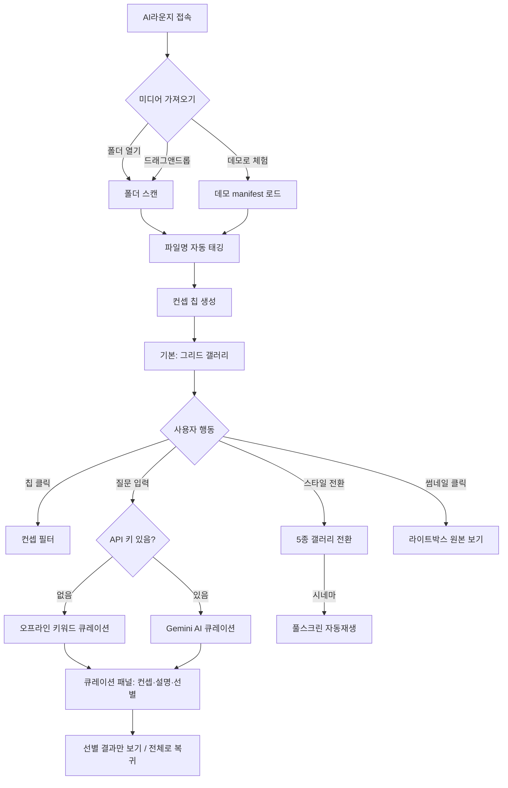

# AI라운지 기획서 — 현장이 묻고, AI가 돕다

## 1. 기획

### 배경
제조 현장은 사진·영상으로 기록되지만, 폴더 속에 잠들어 있다.
"로봇팔 설치할 때 참고할 사진 어디 있지?" — 현장이 물을 때 바로 꺼내 보여주는 공간이 필요하다.

### 컨셉
**현장이 묻고, AI가 돕다.**
영상과 이미지가 담긴 한 폴더를 열면, AI(또는 오프라인 키워드 엔진)가 컨셉에 맞춰 골라주고
5가지 갤러리 스타일로 바꿔 감상하는 웹 라운지.

### 타깃
- 스마트팩토리·제조 현장 기록을 정리하고 싶은 엔지니어
- 현장 사진·영상을 고객·교육용으로 보여줘야 하는 담당자
- 미디어 아카이브를 멋지게 전시하고 싶은 크리에이터

### 핵심 가치
1. **Zero setup** — 설치 없이 폴더 하나 열면 끝
2. **컨셉 자동화** — 파일명만으로 7대 컨셉 자동 태깅
3. **질문형 탐색** — "현장이 묻다" 한 줄 질문 → 관련 미디어 큐레이션
4. **전시 전환** — 같은 미디어를 5가지 스타일로 즉시 전환

### 기능 목록
| 기능 | 설명 | 우선순위 |
|---|---|---|
| 폴더 열기 / 드래그앤드롭 | 영상+이미지 일괄 로드 (blob URL, 서버 전송 없음) | P0 |
| 데모 체험 | 내장 데모 미디어 9종 즉시 로드 | P0 |
| 자동 컨셉 태깅 | 파일명 키워드 사전 → 7대 컨셉 분류 | P0 |
| 컨셉 칩 필터 | 칩 클릭으로 필터링 | P0 |
| 현장이 묻다 (오프라인) | 질문 키워드 스코어링 → 상위 8개 선별 | P0 |
| 현장이 묻다 (AI) | Gemini API → 컨셉 제목·설명·선별 이유 | P1 |
| 갤러리 5종 | 그리드·매서너리·필름스트립·3D 월·시네마 | P0 |
| 라이트박스 | 클릭 시 원본 보기, 영상 재생 | P0 |
| 설정 | Gemini API 키 저장 (localStorage) | P1 |

### 7대 컨셉
로봇·자동화 / 물류·컨베이어 / 데이터·대시보드 / 작업자·AR / 용접·가공 / 야간·전경 / 제어·PLC

### Non-goals
- 서버/DB 없음 (완전 클라이언트, 프라이버시 보장)
- 계정·로그인 없음
- 영상 편집 기능 없음 (전시 전용)

## 2. 유저플로우



### 주요 시나리오
1. **현장 엔지니어**: 현장 사진 폴더 열기 → "용접 불량 사례 보여줘" 질문 → 용접·가공 컨셉 선별 → 3D 월로 회의실에 전시
2. **교육 담당자**: 데모 체험 → 시네마 모드로 교육생에게 자동재생 상영
3. **방문자 응대**: 야간·전경 컨셉 → 필름스트립으로 회사 소개

## 3. 디자인

### 무드
"밤의 공장 라운지" — 어두운 공간에 켜진 조명처럼 미디어가 빛나는 전시형 UI.

### 컬러
| 용도 | 값 |
|---|---|
| 배경 | `#0d0f14` |
| 패널 | `#151923` |
| 경계선 | `#232838` |
| 본문 텍스트 | `#e8eaf0` |
| 보조 텍스트 | `#9aa3b2` |
| 포인트 (앰버) | `#f5a524` → 그라데이션 `#ff7847` |
| AI 뱃지 | `#7c5cff` (보라) |

### 타이포
- Pretendard Variable (CDN)
- 헤드라인: 700 / 본문: 400·500 / 캡션: 12–13px 보조색

### 레이아웃
```
┌─────────────────────────────────────┐
│ 헤더: 로고 AI라운지 | 폴더·데모·설정 │
├─────────────────────────────────────┤
│ 💬 현장이 묻다 [ 질문 입력창____ ]  │
├─────────────────────────────────────┤
│ [큐레이션 결과 패널 - 질문 시 노출]  │
├─────────────────────────────────────┤
│ 스타일 전환: ▦ 🧱 🎞️ 🧊 🎬         │
│ 컨셉 칩: 전체 로봇·자동화 물류...    │
├─────────────────────────────────────┤
│                                     │
│        갤러리 (스타일별 렌더)        │
│                                     │
└─────────────────────────────────────┘
```

### 갤러리 5종 스타일
1. **그리드** — 균일 16:9 카드, 영상 호버 재생. "정리된 아카이브" 느낌
2. **매서너리** — 원본 비율 유지 폭포형. "현장 스케치북" 느낌
3. **필름스트립** — 가로 스냅 스크롤 대형 카드. "프레젠테이션" 느낌
4. **3D 월** — Three.js 곡면 월, 드래그 회전, 클릭 확대. "전시관" 느낌
5. **시네마** — 풀스크린 자동재생 + Ken Burns. "상영회" 느낌

### 인터랙션 원칙
- 모든 전환은 0.25s ease, 스타일 전환 시 갤러리 페이드
- 영상은 목록에서 무음 미리보기, 라이트박스/시네마에서 소리 재생
- 빈 상태(미디어 없음)에서는 3가지 로드 방법을 일러스트+문구로 안내
- 오프라인/AI 모드 뱃지로 현재 큐레이션 방식 명시 (신뢰성)
